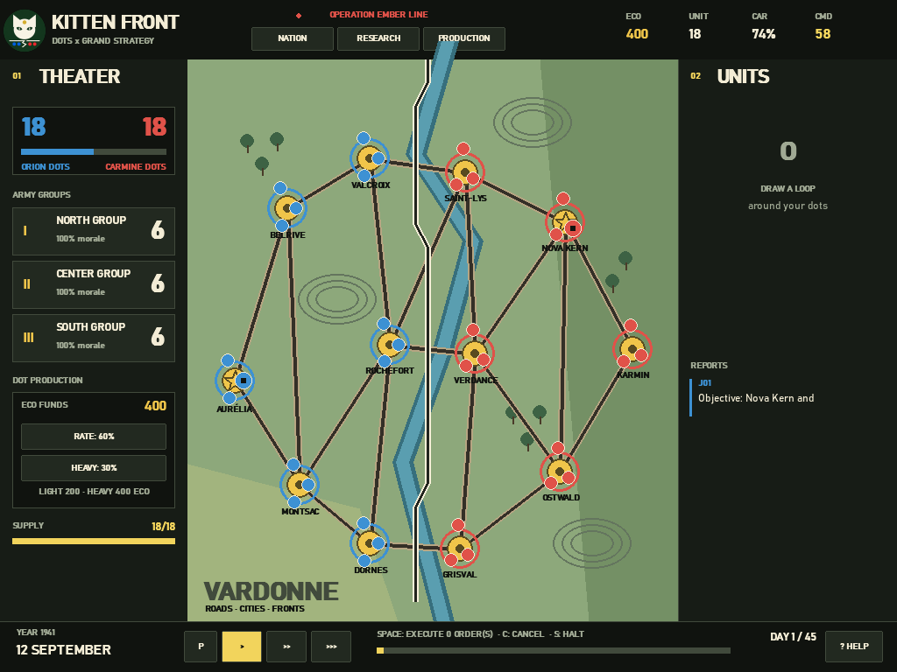

<p align="center">
  
</p>

# KITTEN FRONT

An experimental, AI-assisted strategy game for Windows about dot armies, living front lines, logistics, and command decisions. Play in English or French.

> KITTEN FRONT is an original independent project inspired by map-based and grand-strategy games. It is not affiliated with, endorsed by, or a copy of War of Dots, Hearts of Iron, or Paradox Interactive.



## Features

- Draw offensive paths and launch coordinated attacks across a moving front line.
- Encircle enemy dots, defend cities, and keep armies supplied.
- Manage national focus, research, production, stability, war support, and mobilisation.
- Play a campaign, skirmishes, scenarios, conquest, survival, blitz, or sandbox mode.
- Follow an interactive tutorial and the first-launch briefing hosted by a kitten commander.
- Save matches and customise speed, starting resources, unit density, health bars, front lines, and language.
- Switch between English and French; the choice is remembered automatically.

## Download

Windows builds are produced automatically by GitHub Actions. Each tagged release contains:

- `KITTEN-FRONT-Setup.exe` — recommended Windows installer;
- `KITTEN FRONT.exe` — portable executable.

Until the first release is published, the latest package can be downloaded from the repository's **Actions** page after a successful `Windows build` run.

## Run from source

KITTEN FRONT requires Python 3.10 or newer.

```powershell
python -m venv .venv
.\.venv\Scripts\Activate.ps1
python -m pip install -r requirements.txt
python main.py
```

On Windows, `lancer_kitten_front.bat` can also launch an already configured copy.

## Controls

| Action | Control |
| --- | --- |
| Select dots | Draw a loop with the left mouse button |
| Prepare an offensive | Drag a path from selected dots |
| Launch all prepared plans | `Space` |
| Clear prepared plans | `C` |
| Stop and defend | `S` |
| Pause | `P` |
| Game speed | `1`, `2`, `3` |
| Close a panel / pause menu | `Escape` |

Stationary units receive a defensive advantage. Cities produce economy, heal garrisons, and supply nearby troops. Cut-off units lose supply and gradually collapse.

## Build for Windows

Create the portable executable:

```powershell
.\build_exe.ps1
```

Create the executable and installer (requires [Inno Setup 6](https://jrsoftware.org/isinfo.php)):

```powershell
.\build_installer.ps1
```

Outputs are written to `dist\` and are intentionally excluded from Git.

## Tests

```powershell
python -m unittest -v
```

## Français

KITTEN FRONT est un jeu de stratégie original pour PC : tracez vos offensives, stabilisez une ligne de front vivante, encerclez les forces ennemies et gérez recherche, production et ravitaillement. La présentation, les menus, le tutoriel et le jeu sont disponibles en français depuis **Settings / Paramètres → Language / Langue**.

Le guide complet pour mettre le dépôt et ses versions en ligne se trouve dans [docs/PUBLISHING.md](docs/PUBLISHING.md).

## Contributing and security

Contributions and reports are welcome in English or French. Read [CONTRIBUTING.md](CONTRIBUTING.md) before opening a pull request. Please report security-sensitive problems according to [SECURITY.md](SECURITY.md), not in a public issue.

## License

KITTEN FRONT is free software distributed under the [GNU GPL-3.0-or-later](LICENSE).
